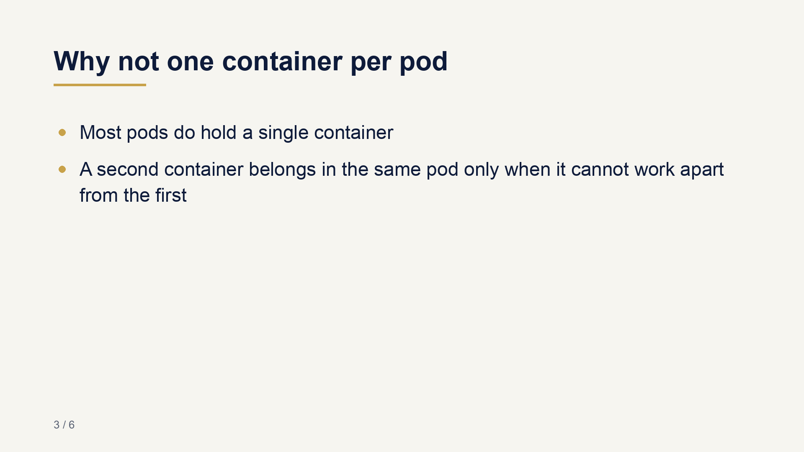
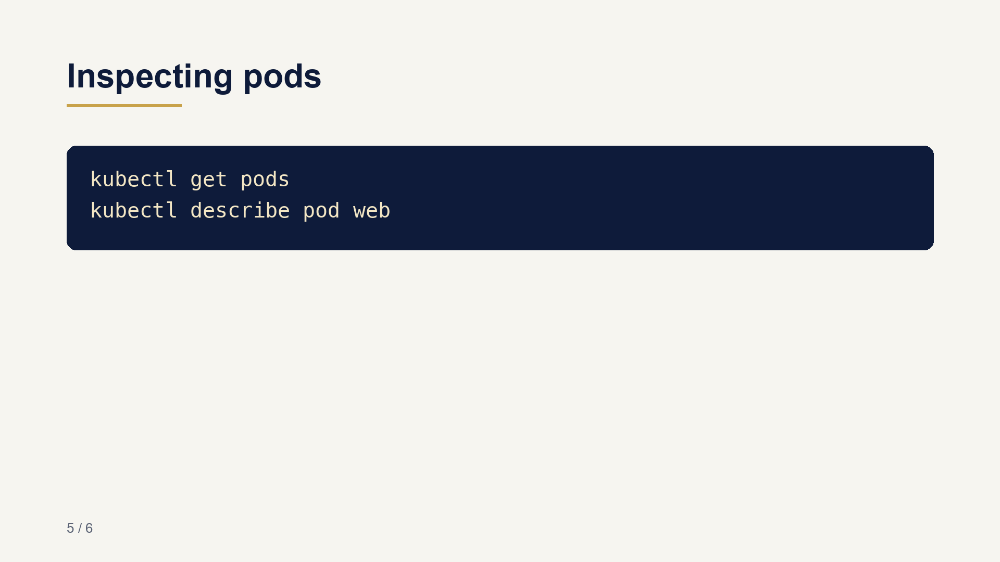

# doc2video

[](https://github.com/yurri775/doc2video/actions/workflows/tests.yml)

**Turn a Markdown document into a narrated lesson video, with slides, voice-over and subtitles.**

```bash
python -m doc2video examples/pods.md -o pods.mp4 --voice say:Samantha
```

| Title | Content | Code |
|---|---|---|
|  |  |  |

The [example document](examples/pods.md) gives a 47-second video with six slides and a
synchronised `.srt` file, rendered entirely offline in a few seconds.

## What it does

1. **Plan.** Headings become slide titles, lists become bullets, fenced code becomes a code
   slide, the section's prose becomes the narration, and a recap closes the lesson. The
   default planner is *extractive*: it never writes a word that is not in the document.
   Long sentences are cut at a clause boundary, never mid-thought.
2. **Render.** Each slide is drawn at 1920x1080 with Pillow: no browser, no office suite.
3. **Speak.** A pluggable voice writes one WAV per slide and reports its duration.
4. **Assemble.** ffmpeg turns each slide into a segment as long as its narration (plus a
   short pause), concatenates them without re-encoding, and an SRT file is written with one
   cue per sentence, timed in proportion to its length.

Intermediate files stay in `<output>.work/` so they can be inspected.

## Install

```bash
python -m venv .venv && . .venv/bin/activate
pip install -e ".[dev]"        # needs ffmpeg on the PATH
pytest                          # includes a full build with the silent voice
```

## Voices

| `--voice` | Engine | Notes |
|---|---|---|
| `say`, `say:Thomas` | macOS `say` | offline, any installed voice (`say -v '?'`) |
| `silent` | none | silence as long as the text would take to read; for CI and timing previews |

Any engine fits the two-line `Voice` protocol (`speak(text, out_wav) -> seconds`). When
choosing one for production, prefer engines that predict the duration of the whole
utterance: purely autoregressive ones occasionally insert breaths or noises mid-sentence,
which is hard to catch across hundreds of clips.

## Letting a model write the slides

[`examples/llm_planner.py`](examples/llm_planner.py) replaces the extractive planner with a
model, wrapped by [guardloop](https://github.com/yurri775/guardloop): retries and model fallback,
a cost journal, and rules checked before anything is rendered (bullet length, narration
length, every command copied verbatim from the document). Violations are sent back to the
model for a targeted repair.

## Background

This is an independent, generic rewrite of ideas I first applied in an LLM pipeline that
produced narrated training videos at scale.

## License

MIT, see [LICENSE](LICENSE).
